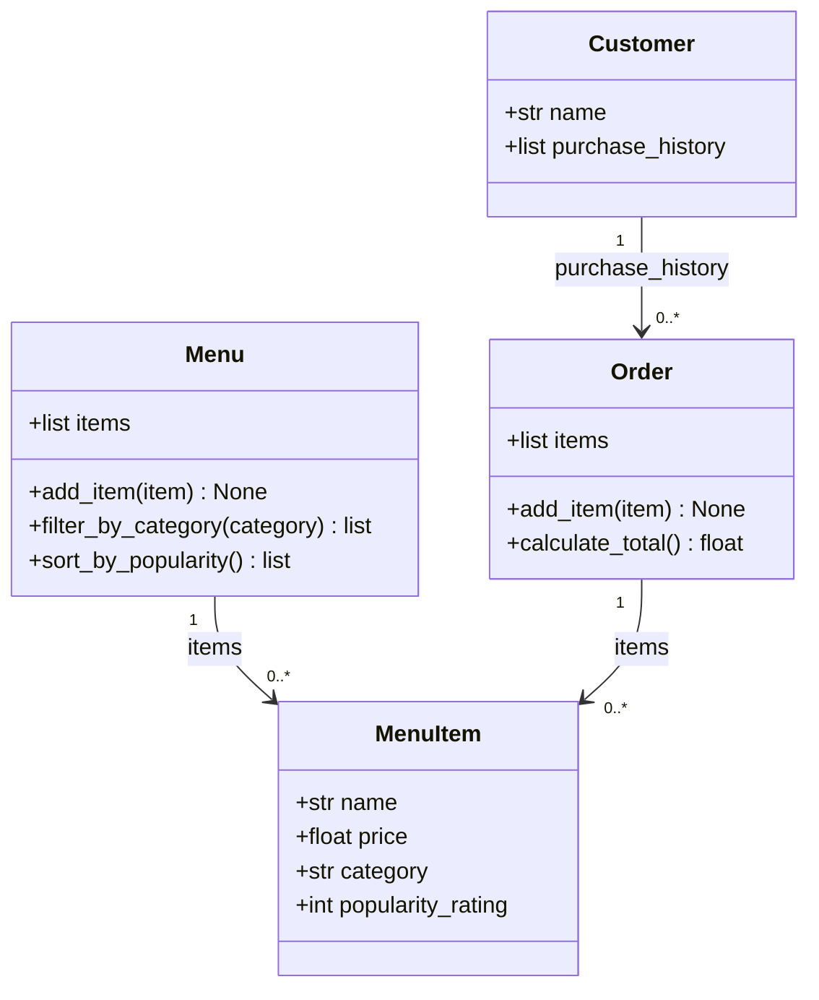

# ByteBites

A Python backend for the AI110 Week 3 campus food ordering lab.

## Classes

- Customer: name and purchase history.
- MenuItem: name, price, category, and popularity rating.
- Menu: add items, filter categories, and sort by popularity.
- Order: selected items and total cost.

## Run Tests

    python3 -m venv .venv
    source .venv/bin/activate
    python -m pip install pytest
    python -m pytest

## Verification

All 6 tests passed, covering totals, empty orders, filtering, missing categories, sorting, and empty menus. Sorting preserves the original menu.

## AI Collaboration

AI helped draft the diagrams, classes, methods, and tests. I verified the behavior with manual examples and pytest.

## Class Diagram

[Mermaid source](bytebites_design.mmd)

