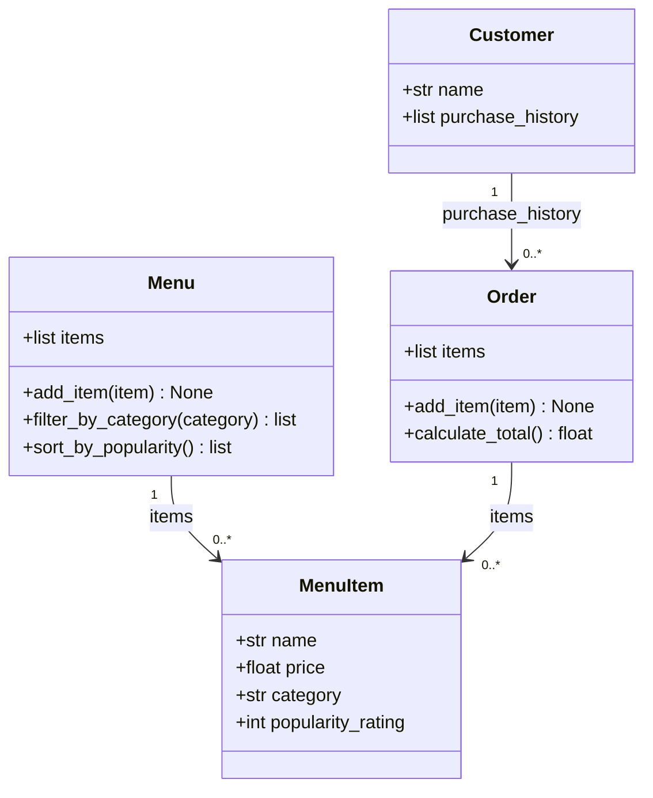

# ByteBites

A simple Python backend for a campus food ordering app, built for the AI110 Week 3 Tinker lab.

## Classes

- Customer stores a name and purchase history.
- MenuItem stores an item's name, price, category, and popularity rating.
- Menu holds items, filters by category, and sorts by popularity.
- Order holds selected items and calculates the total cost.

Filtering and sorting return new lists without changing the original menu. Popularity sorting puts the highest rating first. An empty order returns a total of 0.0.

## Project Files

- bytebites_spec.md — feature request and candidate classes.
- ByteBites_Design_Reference.md — project scope and AI guidance.
- draft_from_copilot.mmd — initial Mermaid class diagram.
- bytebites_design.mmd — refined Mermaid class diagram.
- models.py — four classes and their methods.
- test_bytebites.py — automated tests.

## Setup

Create and activate a virtual environment on macOS:

```bash
python3 -m venv .venv
source .venv/bin/activate
```

Install pytest and run the tests:

```bash
python -m pip install pytest
python -m pytest
```

## Verification

All 6 tests passed. They cover order totals, empty orders, category filtering, missing categories, popularity sorting, and empty menus.

Manual checks also confirmed that customer details and purchase history could be stored and that sorting left the original menu unchanged.

## AI Collaboration

AI helped draft the class diagrams, class scaffolds, methods, and tests. I checked the results against the specification and ran manual examples and automated tests.

The refined diagram kept the same four classes and clarified how customers relate to past orders and how menus and orders contain items. A syntax issue in the AI's first total-calculation suggestion was corrected before the manual checks passed.

## Class Diagram

The final design is in [bytebites_design.mmd](bytebites_design.mmd).

